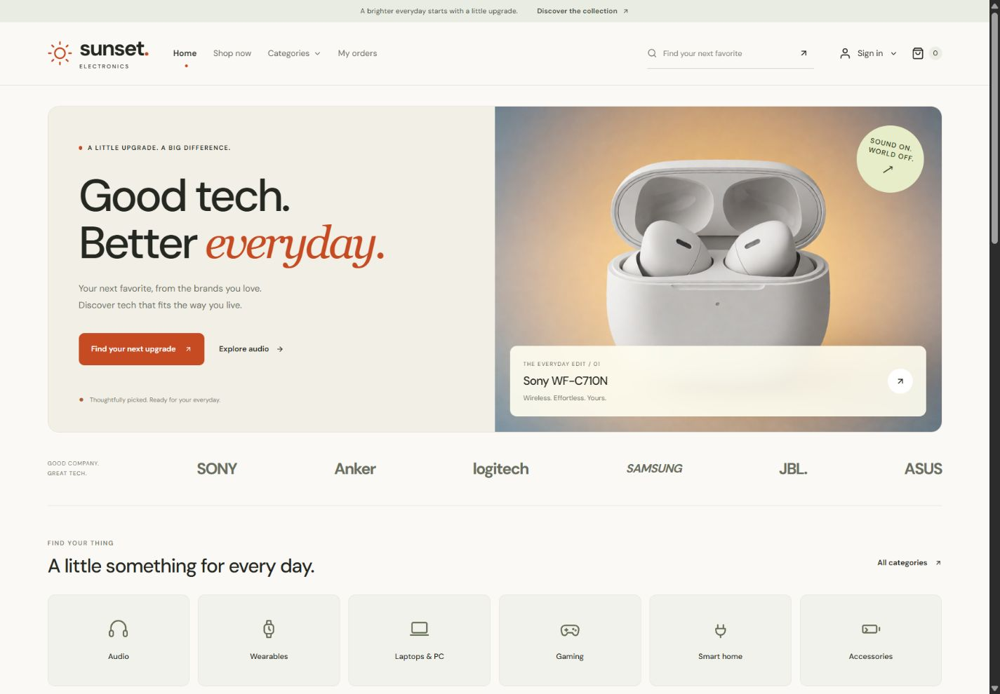

# Sunset Electronics — Final Project Frontend

React storefront and operations workspace for the Web & Mobile Application Development project. This branch contains the updated UI and its current mockups, based on the existing mock data flows.

## Preview



## Run locally

Use Node.js 22.12+ compatible with Vite 8 and the installed dependencies.

```powershell
cd frontend
npm ci
npm run dev -- --port 5174
```

Open the local URL printed by Vite. Build with `npm run build` from frontend. Demo account shortcuts on sign-in cover buyer, staff, manager and admin; these are fictional browser mock accounts.

## Current contents

- [frontend/](frontend/README.md): current React application, assets and UI styles.
- [Mockup gallery and page specifications](docs/README.md): current desktop/mobile captures.
- [Figma editable design](https://www.figma.com/design/B6wD9LAN70E4nrLjoJQPsQ).
- [UI system](docs/UI-SYSTEM.md) and [capture workflow](docs/RENDER.md).
- [Implementation status](docs/IMPLEMENTATION.md): current scope and verification limits.
- [Architecture](docs/ARCHITECTURE.md) and [requirements](docs/PRD.md): functional reference.
- [Historical midterm documentation](docs/legacy-midterm/README.md); its original renderer is identified in [_mockup-build](_mockup-build/README.md).

## Current behavior

Home, Shop now, Categories and My orders navigation; six category filters; numbered three-step checkout; role-filtered operations navigation with disabled staff storefront link. Existing auth redirects, purchasing, order status, reviews, stock and user-management flows remain in the frontend mock.

This frontend checkpoint excludes backend code, environment secrets, SQLite databases, dependencies and generated build output. Local backend learning work remains separate. No merge to main is performed by this update.

## Verification

Frontend source build passed and the existing mock API smoke suite reports 32 passed, 0 failed. Updated screenshots were taken on 22 October 2026 from the same UI source. Screenshots are visual evidence and do not establish a complete regression or accessibility audit.
