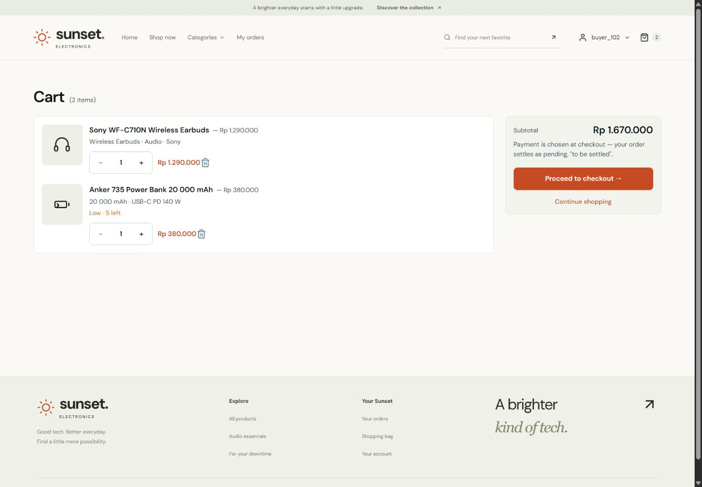

# Shopping bag — Final Project UI

Updated 22 October 2026 from the implemented React frontend.

- Route: `/cart`
- Access: Buyer
- Source: [CartPage.jsx](../../frontend/src/pages/CartPage.jsx)
- Shared visual rules: [UI system](../UI-SYSTEM.md)

## Layout and behavior

- Existing cart rows, quantity controls, remove actions, subtotal and order-summary panel.
- Proceed to checkout follows the existing wizard. Cart data remains a browser mock in this branch.
- Mobile retains the existing total/action presentation.

## Current mockups

### mockup.jpg

Data is fictional browser mock data. Screenshots describe the current interface; route guards, form validation and the data facade remain implemented in React. See [capture notes](../RENDER.md).
