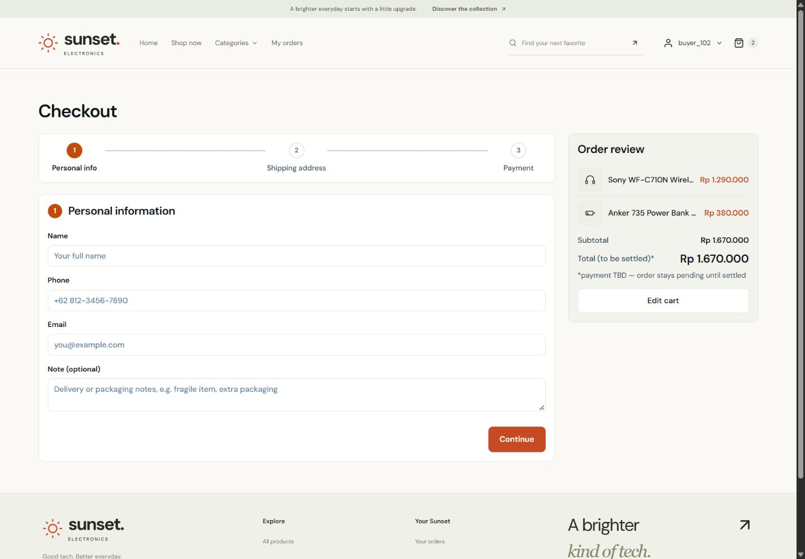
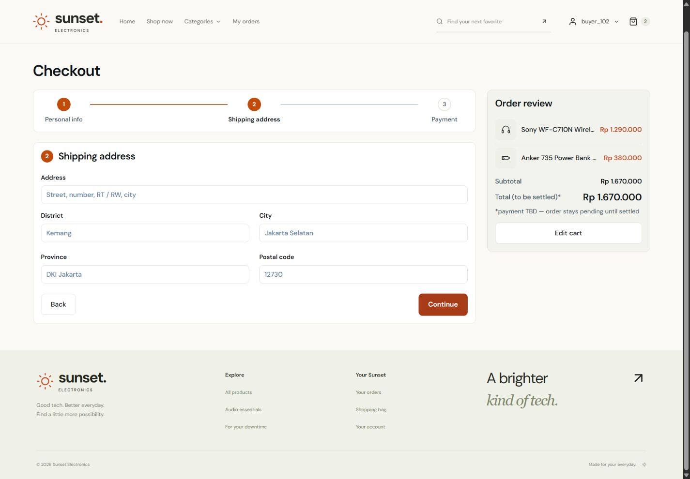
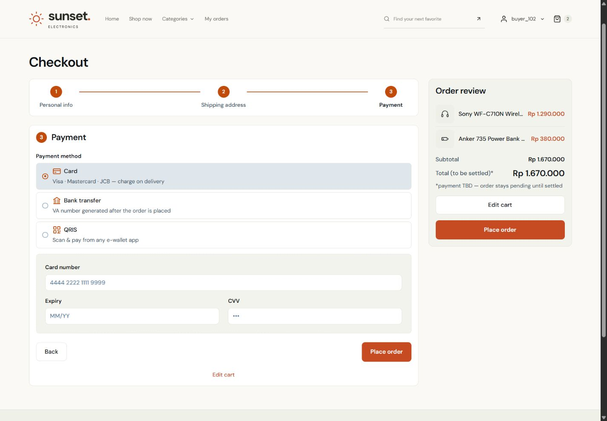
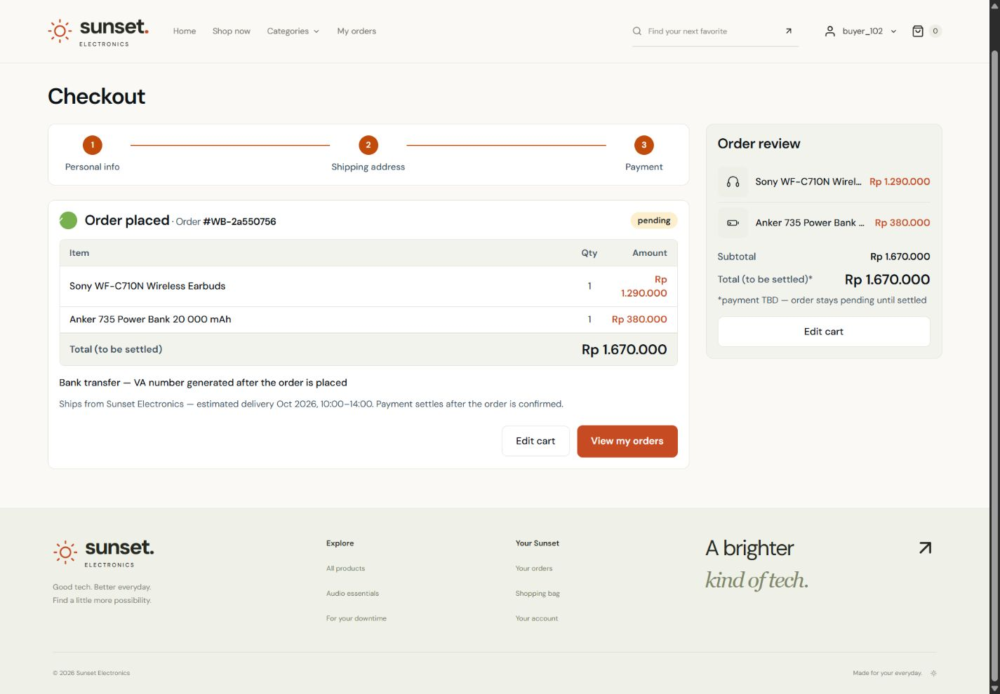
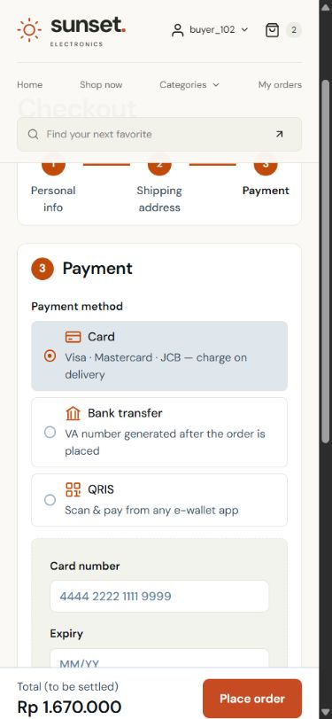

# Checkout — Final Project UI

Updated 22 October 2026 from the implemented React frontend.

- Route: `/checkout`
- Access: Buyer
- Source: [CheckoutPage.jsx](../../frontend/src/pages/CheckoutPage.jsx)
- Shared visual rules: [UI system](../UI-SYSTEM.md)

## Layout and behavior

- Numbered progress circles 1–2–3, Personal information, Shipping address and Payment.
- Existing validation, Back/Continue, Edit cart, stock conflicts, receipt and pending/to-be-settled order remain.
- Screenshots cover all three steps and the receipt using fictional local mock data.

## Current mockups

### mockup.jpg

### mockup-step2-shipping.jpg

### mockup-step3-payment.jpg

### mockup-receipt.jpg

### mockup-mobile.jpg

Data is fictional browser mock data. Screenshots describe the current interface; route guards, form validation and the data facade remain implemented in React. See [capture notes](../RENDER.md).
