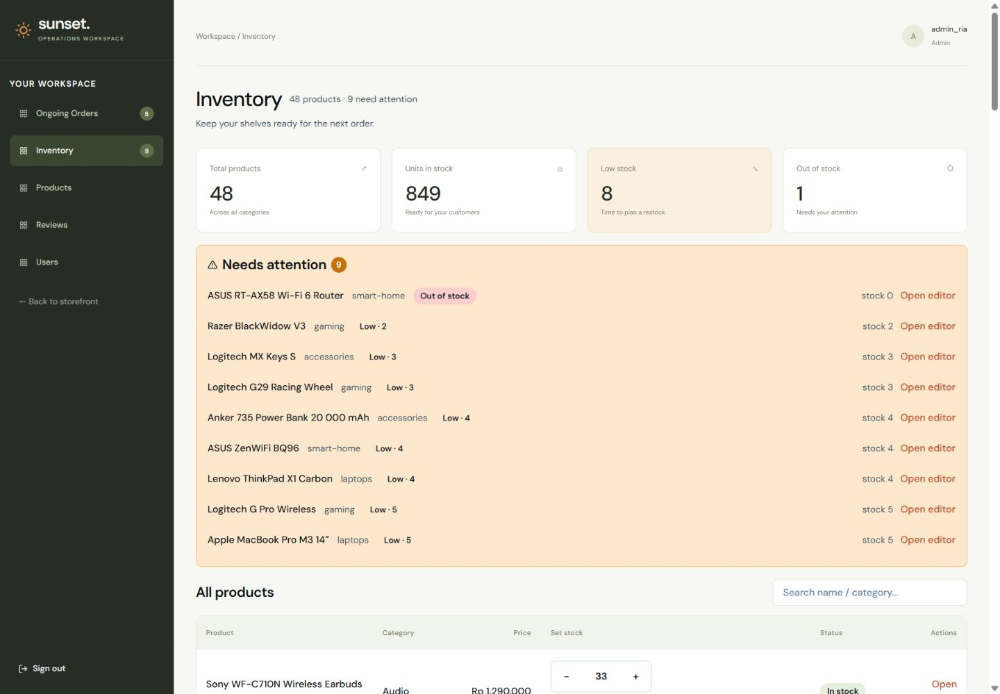

# Shared operations workspace — Final Project UI

Updated 22 October 2026 from the implemented React frontend.

- Route: `/ops/inventory`
- Access: Staff / manager / admin (role-specific controls)
- Source: [../layouts/OpsShell.jsx](../../frontend/src/layouts/OpsShell.jsx)
- Shared visual rules: [UI system](../UI-SYSTEM.md)

## Layout and behavior

- Dark shared sidebar, workspace header, role-filtered menu and sign out.
- Orders, Inventory and Products are available in the base ops tier; Reviews and Users follow their existing guards.
- Back to storefront is deliberately disabled according to the agreed access flow.

## Current mockups

### mockup.jpg

Data is fictional browser mock data. Screenshots describe the current interface; route guards, form validation and the data facade remain implemented in React. See [capture notes](../RENDER.md).
