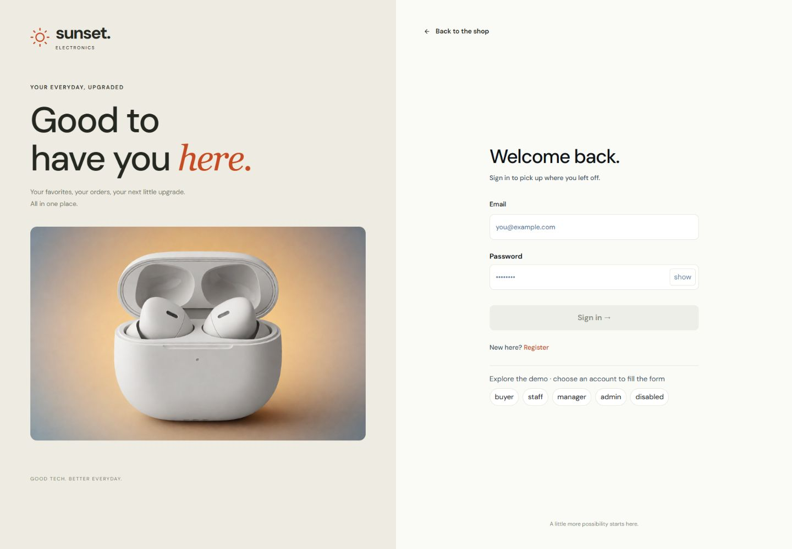

# Sign in — Final Project UI

Updated 22 October 2026 from the implemented React frontend.

- Route: `/login`
- Access: Anonymous
- Source: [LoginPage.jsx](../../frontend/src/pages/LoginPage.jsx)
- Shared visual rules: [UI system](../UI-SYSTEM.md)

## Layout and behavior

- Two-panel auth layout with warm product photography, Welcome back copy and the existing email/password form.
- Role demo buttons fill credentials; submit uses the existing mock auth and role redirects.
- Pending buyer purchase returns to its intended product.

## Current mockups

### mockup.jpg

Data is fictional browser mock data. Screenshots describe the current interface; route guards, form validation and the data facade remain implemented in React. See [capture notes](../RENDER.md).
