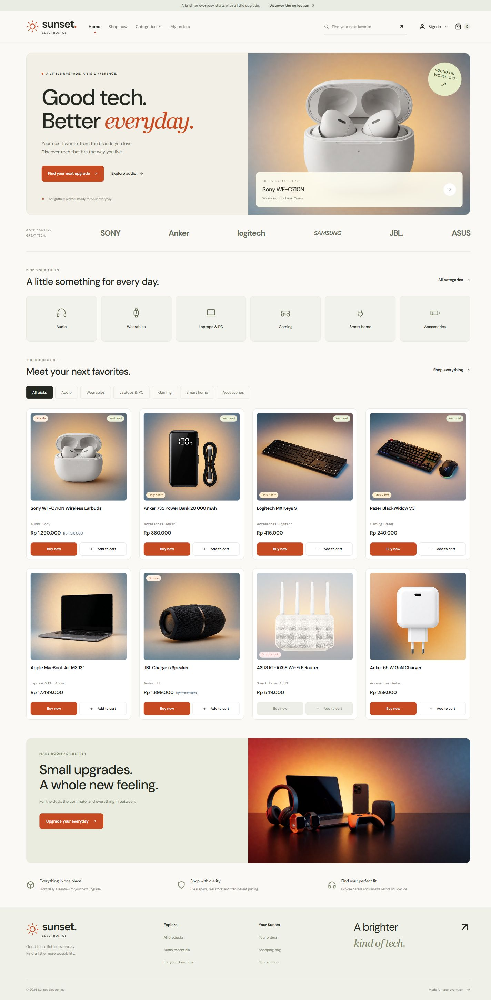
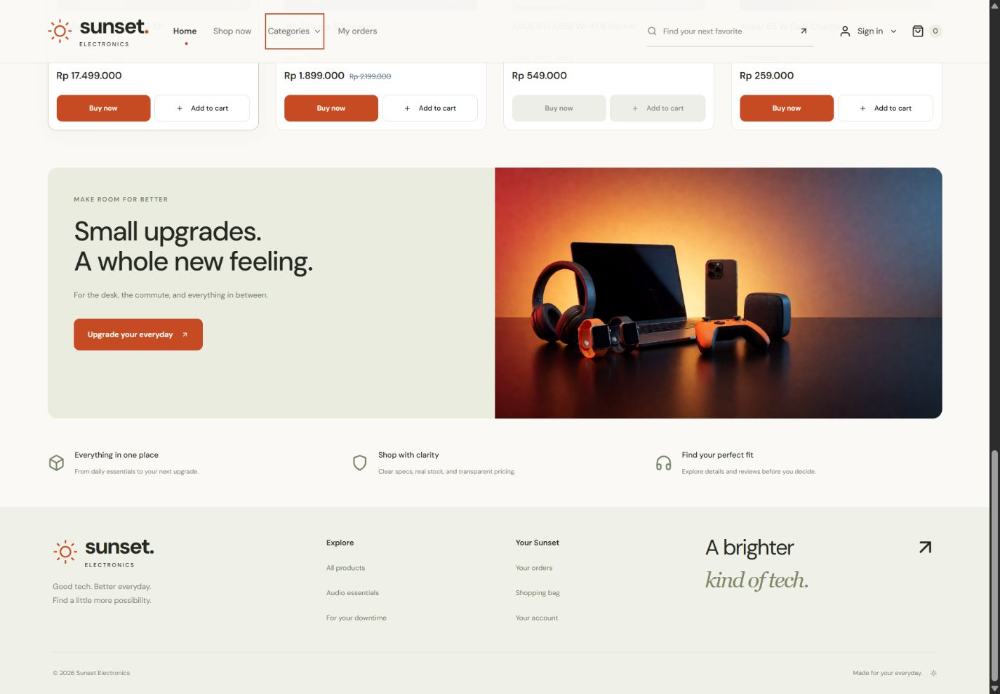
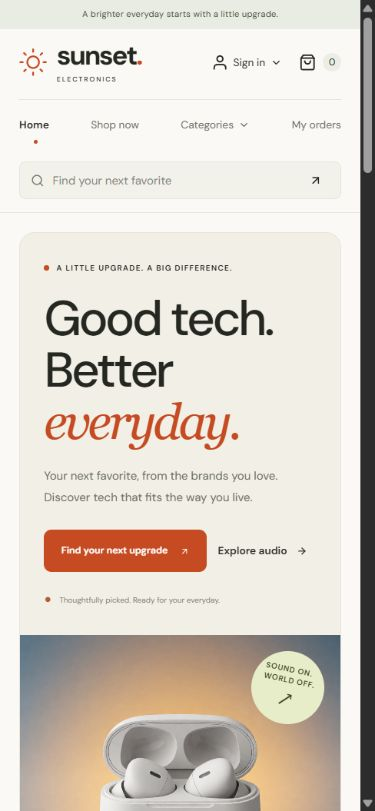
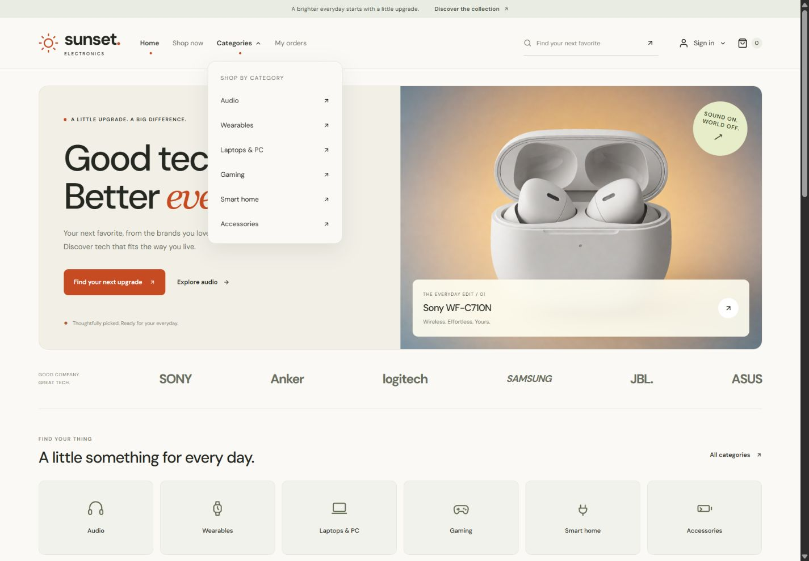
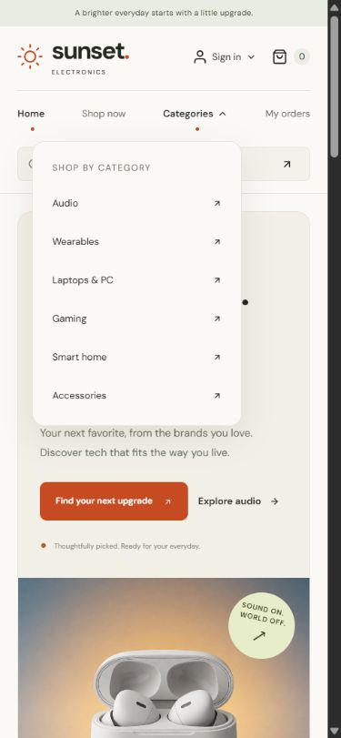

# Storefront — Final Project UI

Updated 22 October 2026 from the implemented React frontend.

- Route: `/`
- Access: Guest / buyer
- Source: [HomePage.jsx](../../frontend/src/pages/HomePage.jsx)
- Shared visual rules: [UI system](../UI-SYSTEM.md)

## Layout and behavior

- Hero, brand strip, six category cards, featured tabs, product grid and editorial collection.
- Header: Home, Shop now, Categories dropdown and My orders. Category choices open the existing URL filters.
- Desktop header is sticky; mobile keeps all four navigation controls visible.

## Current mockups

### mockup.jpg

### mockup-full.jpg

### mockup-bottom.jpg

### mockup-mobile.jpg

### navigation-desktop.jpg

### navigation-mobile.jpg

Data is fictional browser mock data. Screenshots describe the current interface; route guards, form validation and the data facade remain implemented in React. See [capture notes](../RENDER.md).
