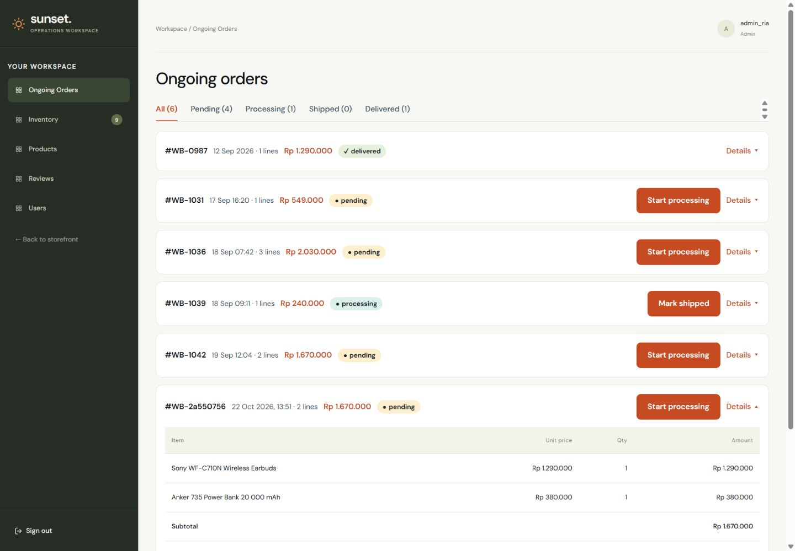
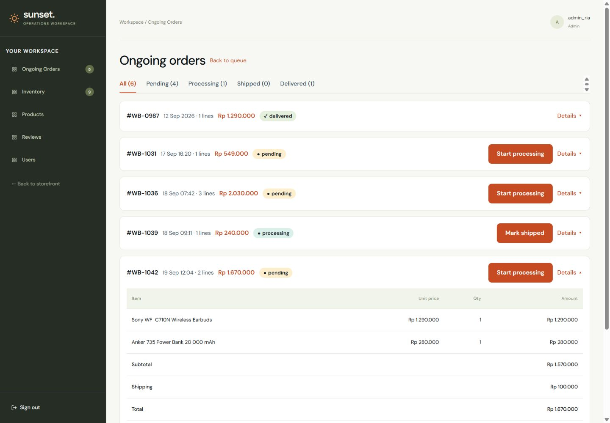

# Operations orders — Final Project UI

Updated 22 October 2026 from the implemented React frontend.

- Route: `/ops/orders`
- Access: Staff / manager / admin
- Source: [OngoingOrdersPage.jsx](../../frontend/src/pages/OngoingOrdersPage.jsx)
- Shared visual rules: [UI system](../UI-SYSTEM.md)

## Layout and behavior

- Order queue with status tabs, expandable receipts and forward-status actions.
- Detail deep link /ops/orders/WB-1042 expands the selected order.
- Existing pending → processing → shipped → delivered transitions are preserved.

## Current mockups

### mockup.jpg

### mockup-detail.jpg

Data is fictional browser mock data. Screenshots describe the current interface; route guards, form validation and the data facade remain implemented in React. See [capture notes](../RENDER.md).
