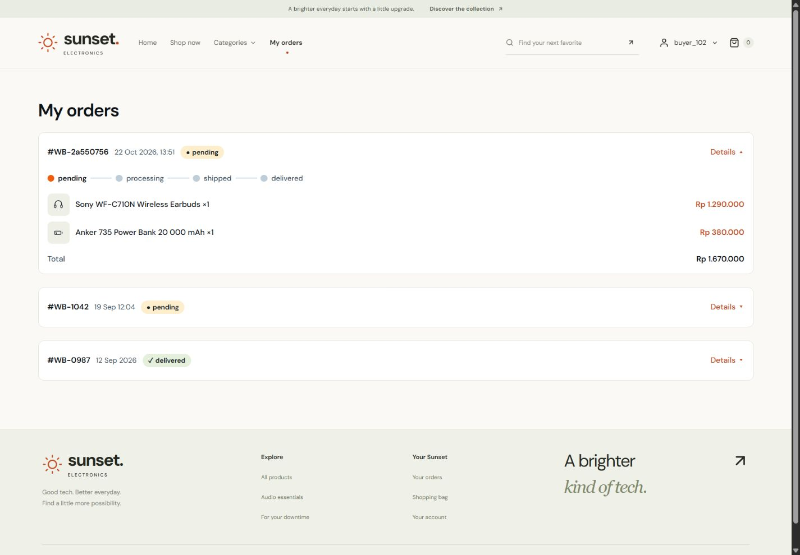

# My orders — Final Project UI

Updated 22 October 2026 from the implemented React frontend.

- Route: `/orders`
- Access: Buyer
- Source: [OrdersPage.jsx](../../frontend/src/pages/OrdersPage.jsx)
- Shared visual rules: [UI system](../UI-SYSTEM.md)

## Layout and behavior

- Buyer order cards with expandable lines, status progress, totals and delivered-order reviews.
- The just-placed local mock order can be pinned and expanded. Buyers have no order-status editing action.
- Counts and records come from the mock state; screenshots are examples, not fixed target numbers.

## Current mockups

### mockup.jpg

Data is fictional browser mock data. Screenshots describe the current interface; route guards, form validation and the data facade remain implemented in React. See [capture notes](../RENDER.md).
