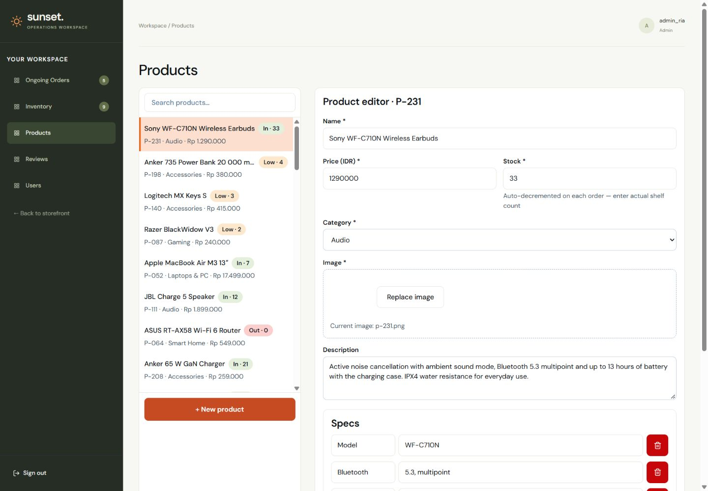
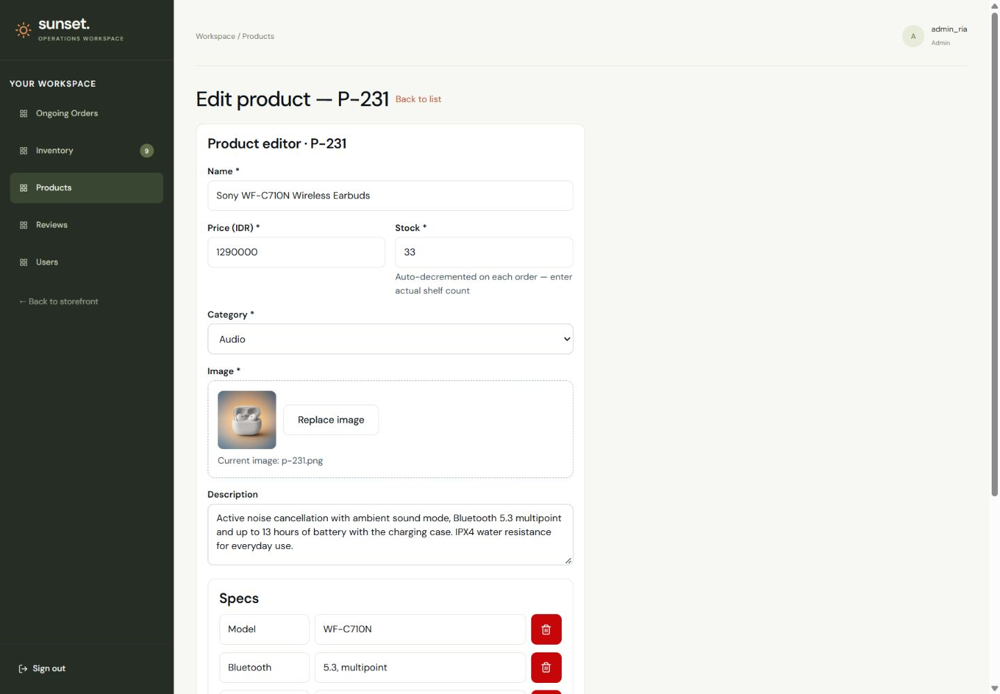

# Products and editor — Final Project UI

Updated 22 October 2026 from the implemented React frontend.

- Route: `/ops/products`
- Access: Staff read-only; manager/admin edit
- Source: [ProductsPage.jsx](../../frontend/src/pages/ProductsPage.jsx)
- Shared visual rules: [UI system](../UI-SYSTEM.md)

## Layout and behavior

- Searchable product list and product form, image, stock, category, description and repeatable specs.
- The separate /ops/products/P-231/edit route uses the same form and role protection.
- A new-product action retains the existing creation flow; no backend upload is introduced.

## Current mockups

### mockup.jpg

### mockup-editor.jpg

Data is fictional browser mock data. Screenshots describe the current interface; route guards, form validation and the data facade remain implemented in React. See [capture notes](../RENDER.md).
