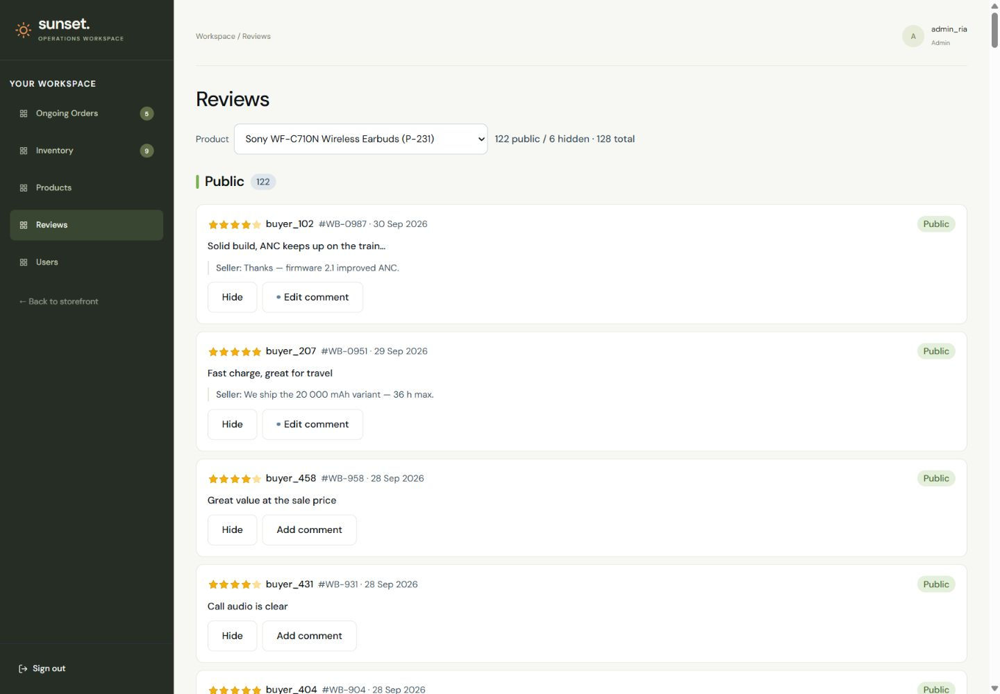

# Review moderation — Final Project UI

Updated 22 October 2026 from the implemented React frontend.

- Route: `/ops/reviews?product=P-231`
- Access: Manager / admin
- Source: [ReviewsPage.jsx](../../frontend/src/pages/ReviewsPage.jsx)
- Shared visual rules: [UI system](../UI-SYSTEM.md)

## Layout and behavior

- Product selector, public/hidden counts, public review list and collapsed hidden section.
- Hide/unhide and seller comment editing retain the existing optimistic update and rollback behavior.
- No approval workflow or deletion feature is added.

## Current mockups

### mockup.jpg

Data is fictional browser mock data. Screenshots describe the current interface; route guards, form validation and the data facade remain implemented in React. See [capture notes](../RENDER.md).
