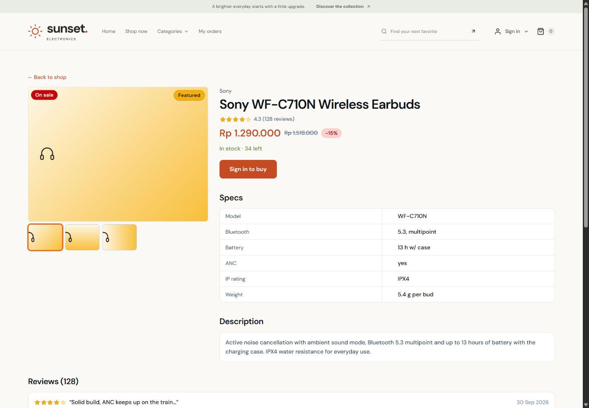

# Product detail — Final Project UI

Updated 22 October 2026 from the implemented React frontend.

- Route: `/products/P-231`
- Access: Public; purchase actions require buyer
- Source: [ProductDetailsPage.jsx](../../frontend/src/pages/ProductDetailsPage.jsx)
- Shared visual rules: [UI system](../UI-SYSTEM.md)

## Layout and behavior

- Product imagery, name, price, stock, specs, quantity and public review content.
- Guests are sent through login for purchase actions; product IDs remain dynamic in normal navigation.
- The screenshot uses Sony P-231 as an example, not a hardcoded destination for every product.

## Current mockups

### mockup.jpg

Data is fictional browser mock data. Screenshots describe the current interface; route guards, form validation and the data facade remain implemented in React. See [capture notes](../RENDER.md).
