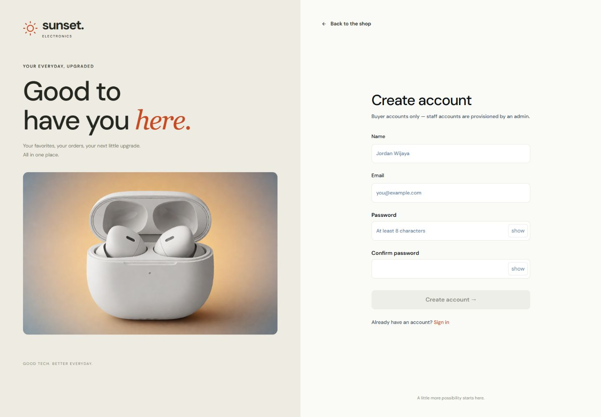

# Create account — Final Project UI

Updated 22 October 2026 from the implemented React frontend.

- Route: `/register`
- Access: Anonymous
- Source: [RegisterPage.jsx](../../frontend/src/pages/RegisterPage.jsx)
- Shared visual rules: [UI system](../UI-SYSTEM.md)

## Layout and behavior

- Shared auth shell with name, email, password and confirmation fields.
- Existing validation, duplicate-email feedback and buyer auto-login are retained.
- Registration does not provision staff, manager or admin through the storefront.

## Current mockups

### mockup.jpg

Data is fictional browser mock data. Screenshots describe the current interface; route guards, form validation and the data facade remain implemented in React. See [capture notes](../RENDER.md).
