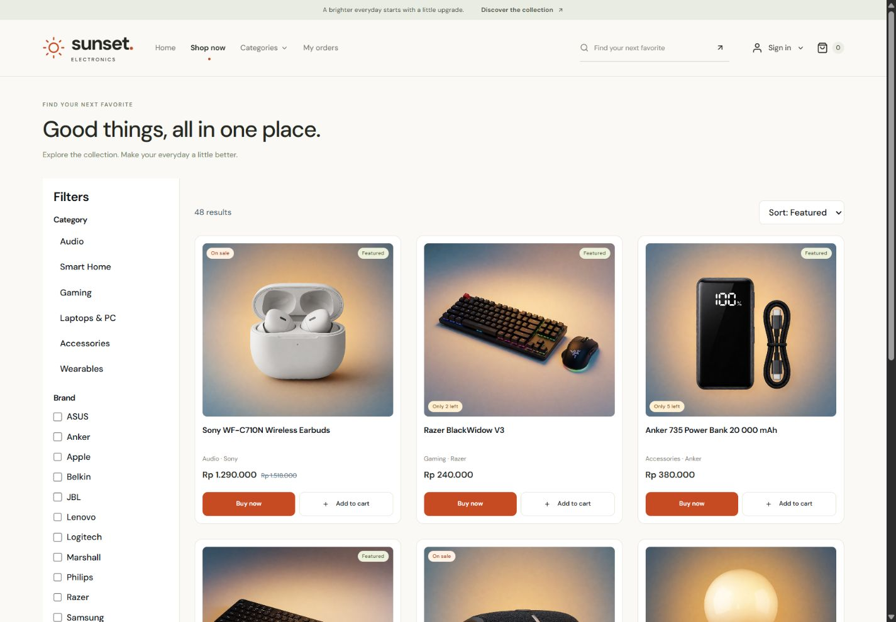

# Catalog — Final Project UI

Updated 22 October 2026 from the implemented React frontend.

- Route: `/search`
- Access: Guest / buyer
- Source: [SearchPage.jsx](../../frontend/src/pages/SearchPage.jsx)
- Shared visual rules: [UI system](../UI-SYSTEM.md)

## Layout and behavior

- Collection introduction, category/brand filters, chips, result count, sort and product grid.
- Search and category state remain in URL query parameters. Shop now opens the unfiltered catalog.
- Mobile exposes the existing filter panel; product cards retain their purchase actions.

## Current mockups

### mockup.jpg

Data is fictional browser mock data. Screenshots describe the current interface; route guards, form validation and the data facade remain implemented in React. See [capture notes](../RENDER.md).
