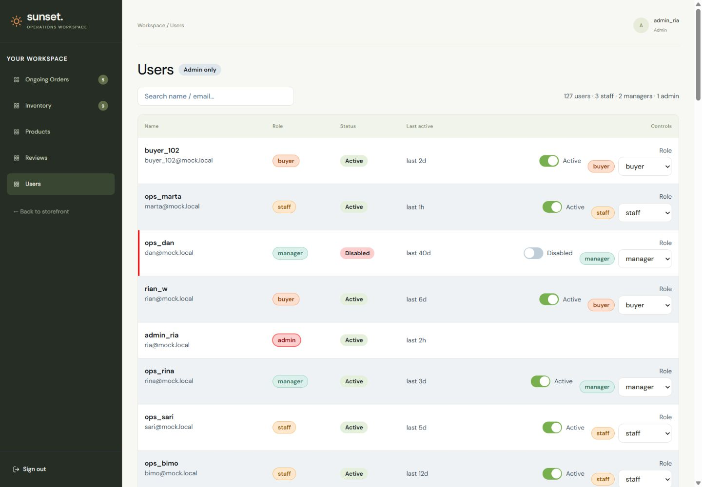

# User administration — Final Project UI

Updated 22 October 2026 from the implemented React frontend.

- Route: `/ops/users`
- Access: Admin
- Source: [UsersPage.jsx](../../frontend/src/pages/UsersPage.jsx)
- Shared visual rules: [UI system](../UI-SYSTEM.md)

## Layout and behavior

- Search, derived user counts, role/status controls and account rows.
- Existing confirmation dialogs, disabled account presentation and own-account control protection remain.
- The mock source currently contains 127 users; UI counts are derived, not forced to a mockup total.

## Current mockups

### mockup.jpg

Data is fictional browser mock data. Screenshots describe the current interface; route guards, form validation and the data facade remain implemented in React. See [capture notes](../RENDER.md).
